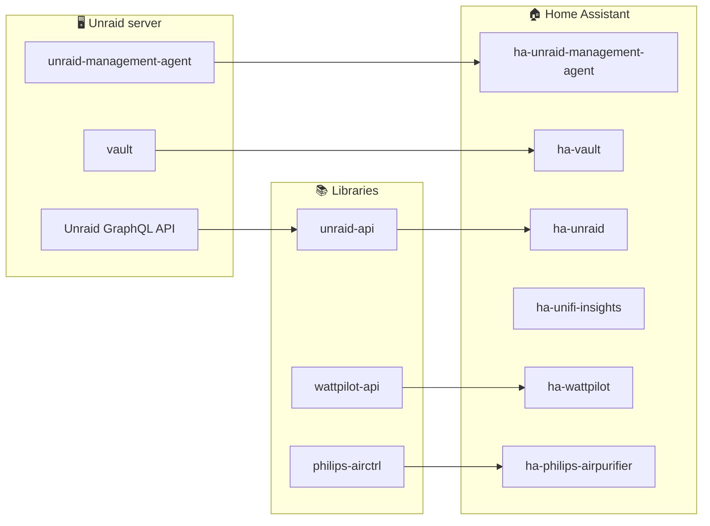

# Tinkerologie

**Open-source tinkering for the smart home and the home lab.**

Home Assistant integrations · Homebridge plugins · Unraid plugins · async Python & Go libraries

---

## 👋 About

Tinkerologie is home to integrations, plugins and libraries that connect the devices and servers in your
home — so you can monitor and control them locally, from Home Assistant, Apple Home or your Unraid server.

- 🏠 **Local first** — talk to devices over your own network wherever the hardware allows.
- 🧩 **Built to fit together** — each integration sits on a typed, async client library you can reuse.
- 🧪 **Tested and maintained** — CI, coverage and automated dependency updates on every project.

---

## 🏠 Home Assistant integrations

Install through [HACS](https://hacs.xyz/). Integrations marked  are in the default store; add the others as a custom repository.

| Integration | What it does | |
| --- | --- | --- |
| [**ha-unraid**](https://github.com/tinkerologie/ha-unraid) | Monitor and control Unraid — system metrics, Docker, VMs, UPS and alerts  |  |
| [**ha-unraid-management-agent**](https://github.com/tinkerologie/ha-unraid-management-agent) | Home Assistant integration for the Unraid Management Agent  |  |
| [**ha-vault**](https://github.com/tinkerologie/ha-vault) | Monitor jobs and trigger backups from the Vault Unraid plugin |  |
| [**ha-unifi-insights**](https://github.com/tinkerologie/ha-unifi-insights) | UniFi Network and Protect monitoring and control via the official UniFi APIs  |  |
| [**ha-philips-airpurifier**](https://github.com/tinkerologie/ha-philips-airpurifier) | Local control of Philips air purifiers |  |
| [**ha-actronair-neo**](https://github.com/tinkerologie/ha-actronair-neo) | ActronAir Neo air conditioning climate control |  |
| [**ha-wattpilot**](https://github.com/tinkerologie/ha-wattpilot) | Control Fronius Wattpilot EV chargers |  |
| [**ha-globird**](https://github.com/tinkerologie/ha-globird) | GloBird energy integration |  |
| [**ha-translink**](https://github.com/tinkerologie/ha-translink) | Translink Queensland public transport |  |

---

## 🍎 Homebridge plugins

Bring your devices into Apple Home. Install from the Homebridge UI or `npm`.

| Plugin | What it does | |
| --- | --- | --- |
| [**homebridge-actronair-neo**](https://github.com/tinkerologie/homebridge-actronair-neo) | ActronAir Neo air conditioning in HomeKit |  |
| [**homebridge-philips-airctrl**](https://github.com/tinkerologie/homebridge-philips-airctrl) | Philips air purifiers in HomeKit |  |
| [**homebridge-unifi-protect-api**](https://github.com/tinkerologie/homebridge-unifi-protect-api) | UniFi Protect via the official API |  |
| [**homebridge-ventair-ceiling-fan**](https://github.com/tinkerologie/homebridge-ventair-ceiling-fan) | Ventair Skyfan DC ceiling fans over your local network |  |

---

## 🖥️ Unraid plugins

Install from **Community Applications** using the [unraid-apps](https://github.com/tinkerologie/unraid-apps) repository.

| Plugin | What it does | |
| --- | --- | --- |
| [**unraid-management-agent**](https://github.com/tinkerologie/unraid-management-agent) | Monitor and control Unraid over REST, WebSocket, MCP, Prometheus and MQTT |  |
| [**vault**](https://github.com/tinkerologie/vault) | Back up and restore containers, VMs, ZFS datasets, folders and plugins to disk, SFTP, SMB, NFS, WebDAV or S3 |  |
| [**unraid-apps**](https://github.com/tinkerologie/unraid-apps) | Community Applications templates for the plugins above | |

---

## 📚 Libraries

The building blocks behind the integrations — usable on their own.

| Library | What it does | |
| --- | --- | --- |
| [**unraid-api**](https://github.com/tinkerologie/unraid-api) | Async Python client for the Unraid GraphQL API |  |
| [**unifi-official-api**](https://github.com/tinkerologie/unifi-official-api) | Async Python client for the UniFi Network and Protect APIs |  |
| [**wattpilot-api**](https://github.com/tinkerologie/wattpilot-api) | Async Python client for Fronius Wattpilot wallboxes |  |
| [**philips-airctrl**](https://github.com/tinkerologie/philips-airctrl) | Async Python library and CLI for Philips air purifiers over encrypted CoAP |  |

---

## 🧩 How it fits together

---

## 🧰 Also here

- [**recyclarr-config**](https://github.com/tinkerologie/recyclarr-config) — Recyclarr configuration built on the TRaSH Guides.

---

### 💬 Get involved

Found a bug or have an idea? Open an issue on the relevant repository.
Pull requests are welcome — check the repository's `CONTRIBUTING.md` to get started.

If these projects save you time, consider [**sponsoring**](https://github.com/sponsors/ruaan-deysel) ❤️

Tinkerologie is an independent project. Not affiliated with Home Assistant, Homebridge, Unraid, Ubiquiti, Philips, ActronAir, Fronius, Ventair, GloBird or Translink.

