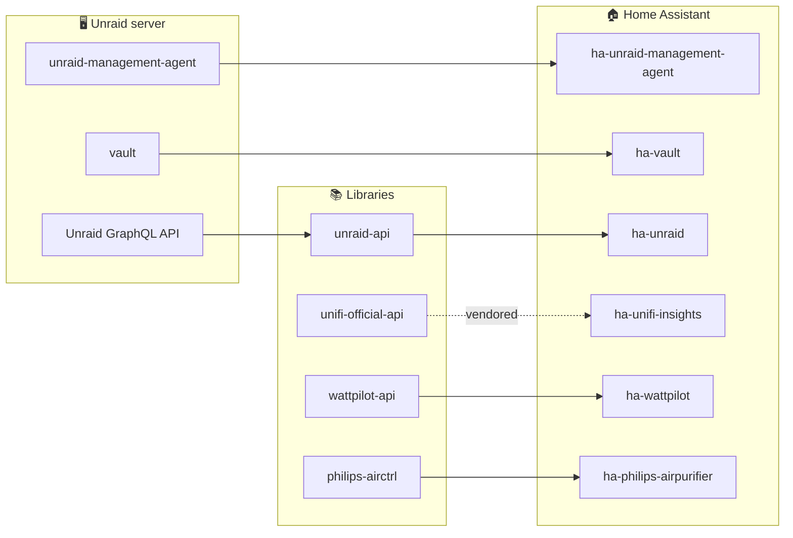

# Tinkerologie

**Open-source tinkering for the smart home and the home lab.**

Integrations, plugins and libraries that connect the devices and servers in your home,
so you can monitor and control them locally.

---

## 👋 About

- 🏠 **Local first.** Talk to devices over your own network wherever the hardware allows.
- 🧩 **Built to fit together.** Integrations sit on typed, async client libraries you can reuse on their own.
- 🧪 **Tested and maintained.** CI and automated dependency updates on every project, with coverage
  tracked on the core libraries and integrations.

---

## 🏠 Home Assistant integrations

Install through [HACS](https://hacs.xyz/). Integrations marked **HACS default** are in the default store;
add the others as a [custom repository](https://hacs.xyz/docs/faq/custom_repositories/).
Install counts come from [Home Assistant analytics](https://analytics.home-assistant.io/custom_integrations) (opt-in, so a lower bound).

| Integration | What it does | |
| --- | --- | --- |
| [**ha-unraid**](https://github.com/tinkerologie/ha-unraid) HACS default | Monitor and control Unraid: system metrics, Docker, VMs, UPS and alerts |   |
| [**ha-unraid-management-agent**](https://github.com/tinkerologie/ha-unraid-management-agent) HACS default | Full Unraid control through the Unraid Management Agent, with real-time WebSocket updates |   |
| [**ha-unifi-insights**](https://github.com/tinkerologie/ha-unifi-insights) HACS default | UniFi Network and Protect monitoring and control via the official UniFi APIs |   |
| [**ha-philips-airpurifier**](https://github.com/tinkerologie/ha-philips-airpurifier) | Local control of Philips air purifiers over encrypted CoAP |  |
| [**ha-actronair-neo**](https://github.com/tinkerologie/ha-actronair-neo) | ActronAir Neo air conditioning: zones, modes and setpoints |   |
| [**ha-wattpilot**](https://github.com/tinkerologie/ha-wattpilot) | Monitor and control Fronius Wattpilot EV chargers |  |
| [**ha-vault**](https://github.com/tinkerologie/ha-vault) | Monitor jobs and trigger backups from the Vault Unraid plugin |  |
| [**ha-globird**](https://github.com/tinkerologie/ha-globird) | GloBird Energy electricity and gas accounts: balances, invoices and smart-meter usage |  |
| [**ha-translink**](https://github.com/tinkerologie/ha-translink) | Translink Queensland real-time departures, journey planning and live vehicle tracking |  |

---

## 🍎 Homebridge plugins

Bring your devices into the Apple Home app. Install from the Homebridge UI or with `npm`.

| Plugin | What it does | |
| --- | --- | --- |
| [**homebridge-actronair-neo**](https://github.com/tinkerologie/homebridge-actronair-neo) | ActronAir Neo air conditioning in HomeKit |   |
| [**homebridge-ventair-ceiling-fan**](https://github.com/tinkerologie/homebridge-ventair-ceiling-fan) | Ventair Skyfan DC ceiling fans over your local network |   |
| [**homebridge-philips-airctrl**](https://github.com/tinkerologie/homebridge-philips-airctrl) | Philips air purifiers in HomeKit |   |
| [**homebridge-unifi-protect-api**](https://github.com/tinkerologie/homebridge-unifi-protect-api) | UniFi Protect cameras, HomeKit Secure Video and sensors via the official API |   |

---

## 🖥️ Unraid plugins

Install from **Community Applications** using the [unraid-apps](https://github.com/tinkerologie/unraid-apps) templates.

| Plugin | What it does | |
| --- | --- | --- |
| [**unraid-management-agent**](https://github.com/tinkerologie/unraid-management-agent) | Monitor and control Unraid over REST, WebSocket, MCP, Prometheus and MQTT |   |
| [**vault**](https://github.com/tinkerologie/vault) | Back up and restore containers, VMs, ZFS datasets, folders and plugins to disk, SFTP, SMB, NFS, WebDAV or S3 |   |

---

## 📚 Libraries

The building blocks behind the integrations, usable on their own.

| Library | What it does | |
| --- | --- | --- |
| [**unraid-api**](https://github.com/tinkerologie/unraid-api) | Async Python client for the Unraid GraphQL API |   |
| [**philips-airctrl**](https://github.com/tinkerologie/philips-airctrl) | Async Python library and CLI for Philips air purifiers over encrypted CoAP |   |
| [**wattpilot-api**](https://github.com/tinkerologie/wattpilot-api) | Async Python client for Fronius Wattpilot wallboxes |   |
| [**unifi-official-api**](https://github.com/tinkerologie/unifi-official-api) | Async Python client for the official UniFi Network and Protect APIs |   |

---

## 🧩 How it fits together

The Homebridge plugins talk to their devices directly and don't depend on these libraries.

---

<b>🧰 Also here</b>

 

- [**recyclarr-config**](https://github.com/tinkerologie/recyclarr-config): Recyclarr configuration built on the TRaSH Guides.
- [**coderabbit**](https://github.com/tinkerologie/coderabbit): shared CodeRabbit review configuration for every repository.

---

### 💬 Get involved

Found a bug or have an idea? Open an issue on the relevant repository using its bug or enhancement template. 
Pull requests are welcome. Read the [contribution governance](https://github.com/tinkerologie/.github/blob/main/GOVERNANCE.md)
and the repository's `CONTRIBUTING.md` first.

If these projects save you time, consider [**sponsoring**](https://github.com/sponsors/ruaan-deysel) ❤️

Tinkerologie is an independent project, not affiliated with or endorsed by Home Assistant, the Open Home Foundation,
Homebridge, Apple, Lime Technology (Unraid), Ubiquiti, Philips, ActronAir, Fronius, Ventair, GloBird or Translink.
Apple, Apple Home and HomeKit are trademarks of Apple Inc. All other trademarks belong to their respective owners.

